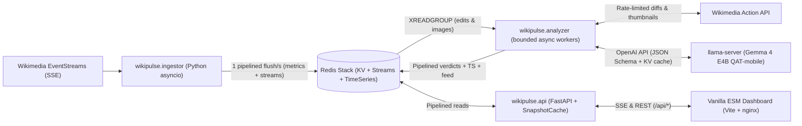
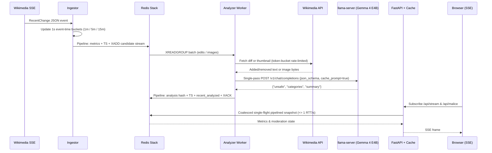

# WikiPulse

Real-time analytics and multimodal content moderation over the live Wikipedia EventStreams firehose.

WikiPulse ingests global Wikipedia edits and file uploads as they happen, computes sliding-window activity metrics, evaluates incoming diffs and images for vandalism or harmful content using a locally served **Gemma 4 E4B QAT-mobile** model, and streams everything to a live dashboard via Server-Sent Events (SSE).

---

## Features

### Real-Time Firehose Analytics
- **Sliding event-time windows (`1m`, `5m`, `15m`)** refreshed every second:
  - **Top edited articles** (excluding `wikidatawiki` and `commonswiki`).
  - **Language / wiki distribution** (top 10 active wikis).
  - **Bot vs. human edit ratio**.
  - **Anonymous (MediaWiki temporary accounts `~YYYY-N-N`) vs. registered ratio**.
- **Global activity telemetry:** live events/sec rate and a 30-minute time-series sparkline (`RedisTimeSeries`).

### Live Content Moderation & Summaries
- **Multilingual edit moderation:** fetches real Wikimedia diffs (and full content for newly created pages) and classifies added text in any language against a Wikipedia-focused semantic hazard taxonomy (`vandalism`, `spam`, `hate_speech`, `harassment`, `doxxing`, `sexual_explicit`, `violence_harm`), keeping neutral encyclopedic coverage safe.
- **Multimodal image moderation:** fetches thumbnails for newly uploaded files and evaluates both visual safety and content description with the same Gemma 4 E4B model.
- **Structural vandalism heuristics:** zero-API metadata checks for page `blanking`, `mass_delete`, and missing edit summaries (`no_comment`).
- **One-sentence English summaries:** optional concise change summaries for edits and visual descriptions for images, generated in the same LLM pass as moderation.

### Live Runtime Controls & API
- **Zero-restart feature toggles (`GET`/`POST /api/config`):** dynamically toggle `detect_edits`, `detect_images`, `summarize`, `exclude_bots`, and `only_anon_new` via Redis; both the ingestor and analyzer pick up changes within ~1 second.
- **SSE & REST endpoints:**
  - `GET /api/stream?window=1m|5m|15m` — live SSE stream of dashboard metrics.
  - `GET /api/metrics/snapshot?window=1m|5m|15m` — single JSON metrics snapshot.
  - `GET /api/malice` — live SSE stream of moderation rates, hazard breakdown, and recent analyzed feed.
  - `GET /api/malice/snapshot` — single JSON moderation snapshot.
  - `GET /api/config` & `POST /api/config` — read or update live detection toggles.
  - `GET /api/health` — liveness and Redis readiness probe.

---

## Architecture & Design

### Component Architecture



### Runtime Sequence (Moderation & Live Delivery)



### Core Design Choices

- **In-memory event-time sliding windows (`wikipulse.ingestor.windows`):** Each window (`1m`, `5m`, `15m`) stores 1-second buckets keyed by event timestamp alongside incremental running counters. Event insertion and bucket expiration run in O(1) amortized time with bounded memory, delivering live metrics from the first second at >70k events/s on a single core.
- **Single-pass structured inference (`wikipulse.analyzer.prompts` & `llm`):**
  - Moderation and English summarization are requested in a **single** OpenAI-compatible call constrained by a strict `json_schema` (GBNF grammar in `llama-server`). Only the fields required by active toggles are included in the schema.
  - System prompts remain byte-identical across requests so `llama-server` (`--cache-reuse`) reuses the prefilled KV prefix across slots.
  - Independent async consumer loops process edits and images concurrently under a shared `asyncio.Semaphore` aligned with `llama-server --parallel`.
- **Coalesced API reads (`wikipulse.api.cache` & `store`):** Every metrics or moderation snapshot is read in a single Redis pipeline round-trip and shared across all connected SSE clients via a single-flight TTL cache (`SnapshotCache`). Writing to `POST /api/config` invalidates the moderation cache immediately.
- **Single backend image:** `ingestor`, `analyzer`, and `api` share one Python package (`wikipulse`), one `pyproject.toml`, and one non-root slim `Dockerfile`.

---

## Quick Start (Docker Compose)

### Universal Default (Works Everywhere — CPU, Mobile QAT Q2)

Requires Docker 24+ with `docker compose` (no GPU or Docker plugins required).

```bash
cp .env.example .env       # edit USER_AGENT with your contact info
docker compose up --build
```

The default stack serves Google's mobile QAT quant (`unsloth/gemma-4-E4B-it-qat-mobile-GGUF:UD-Q2_K_XL`) with single-slot inference (`--parallel 1`, `--ctx-size 4096`) so it runs plug-and-play on Windows, macOS, and Linux.

### NVIDIA GPU Acceleration (CUDA, Q4 QAT)

On machines with an NVIDIA GPU and the NVIDIA Container Toolkit, layer the GPU override to run `unsloth/gemma-4-E4B-it-qat-GGUF:UD-Q4_K_XL` with Flash Attention and 4 parallel continuous-batched slots:

```bash
docker compose -f docker-compose.yml -f docker-compose.gpu.yml up --build
```

On first startup, `llama-server` automatically downloads and caches the GGUF and multimodal projector in the persistent `llm-cache` volume.

| Service | Image | Host Port | Role |
|---|---|---|---|
| `redis` | `redis/redis-stack:7.4.0-v7` | `6379`, `8001` | State, Streams, and RedisTimeSeries |
| `ingestor` | `wikipulse-backend` (build `.`) | — | Wikimedia SSE consumer, sliding windows, candidate producer |
| `llm` | `ghcr.io/ggml-org/llama.cpp:server` (`server-cuda` with GPU override) | — | Gemma 4 E4B QAT OpenAI-compatible server (`:8000` internal) |
| `analyzer` | `wikipulse-backend` (build `.`) | — | Concurrent Wikimedia fetcher + Gemma 4 moderation/summarization |
| `api` | `wikipulse-backend` (build `.`) | `8000` | FastAPI REST + SSE server |
| `frontend` | build `./frontend` (nginx) | `80` | Zero-dependency archival folio dashboard + `/api/` reverse proxy |

Endpoints once running:
- Dashboard: `http://localhost/`
- OpenAPI Docs: `http://localhost:8000/docs`
- Healthcheck: `http://localhost:8000/api/health`
- RedisInsight: `http://localhost:8001/`

---

## Local Development

Uses [`uv`](https://docs.astral.sh/uv/) for Python environment management and Docker for Redis + `llama-server`:

```bash
uv sync
make redis       # Redis Stack on :6379
make llm         # Gemma 4 E4B mobile Q2 QAT on :8080 (CPU) — or `make llm-gpu`
make ingestor    # Terminal 1
make analyzer    # Terminal 2
make api         # Terminal 3 (uvicorn --reload on :8000)
make frontend    # Terminal 4 (Vite dev server on :5173)
```

### Testing, Linting & Benchmarks

```bash
uv run pytest                             # Full test suite
uv run ruff check wikipulse tests bench   # Linter
uv run python -m bench.bench_ingestor     # Offline ingestor throughput benchmark
uv run python -m bench.bench_llm          # Live Gemma 4 E4B latency benchmark
```

---

## Repository Layout

```text
wikipulse/
├── pyproject.toml             # Unified package metadata, dependencies, pytest & ruff config
├── Dockerfile                 # Shared slim Python image for ingestor, analyzer, and api
├── docker-compose.yml         # Universal default stack (CPU, mobile Q2 QAT)
├── docker-compose.gpu.yml     # NVIDIA CUDA override (Q4 QAT, parallel batching)
├── Makefile                   # Common ops & local dev shortcuts
├── .env.example               # Environment configuration template
├── wikipulse/
│   ├── core/                  # Typed config, toggles, Redis keys, heuristics, hazard taxonomy
│   ├── ingestor/              # Async SSE client, 1s-bucket sliding windows, pipelined Redis sink
│   ├── analyzer/              # Rate-limited Wikimedia client, Gemma 4 JSON client, concurrent workers
│   └── api/                   # FastAPI app, pipelined Redis store, single-flight cache, routers
├── tests/                     # Unit tests mirroring wikipulse/
├── bench/                     # Throughput, LLM latency, and moderation precision scripts
└── frontend/                  # Vanilla ES Modules + Vite archival folio dashboard (zero runtime deps)
```
